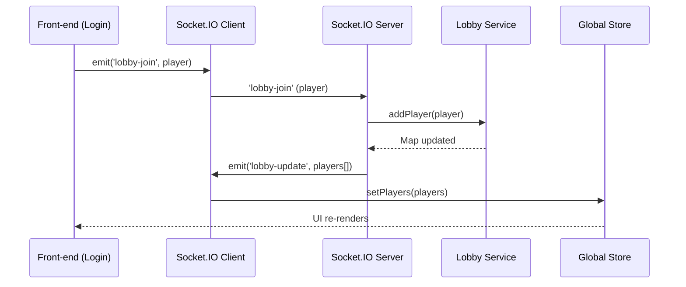
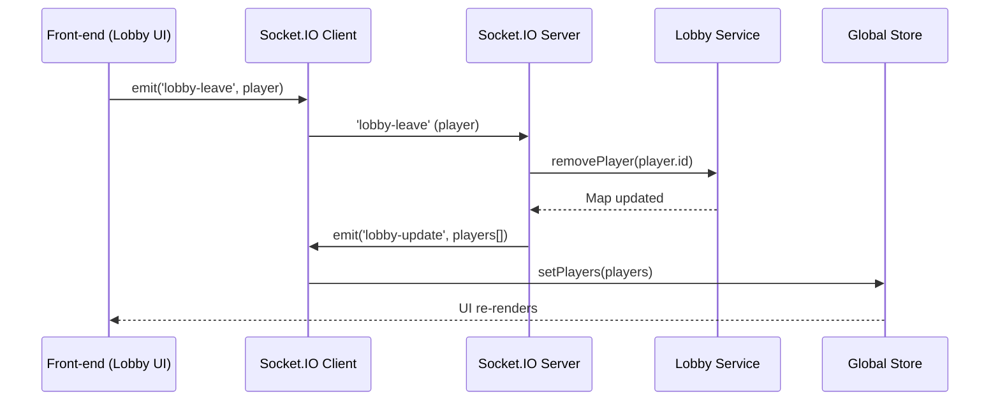

# WebSocket Event Flow

This document describes the real-time communication between front‑end and back‑end for the Tetris‑VS multiplayer lobby.

## Sequence Diagrams

### Lobby Join



**Steps**:
1. User completes login, front‑end emits `'lobby‑join'` with the player object (`{ id, name, image? }`).
2. Server receives the event, calls `Lobby.addPlayer(player)`.
3. Lobby service stores the player in a `Map` keyed by `player.id`.
4. Server broadcasts `'lobby‑update'` with a serialized array of all connected players.
5. All connected clients receive the update and store the new player list in the global Zustand store.
6. Lobby UI component subscribes to the store and re‑renders the player cards.

### Lobby Leave



**Steps**:
1. User clicks “Leave Lobby” button (or disconnects).
2. Front‑end emits `'lobby‑leave'` with the player object.
3. Server receives the event, calls `Lobby.removePlayer(player.id)`.
4. Lobby service deletes the player from the Map.
5. Server broadcasts `'lobby‑update'` with the remaining players.
6. All clients update their store and UI accordingly.

### Event Payloads

#### `'lobby‑join'` / `'lobby‑leave'`
```json
{
  "player": {
    "id": "string (UUID or socket‑id)",
    "name": "string",
    "image": "string (optional avatar URL)"
  }
}
```

#### `'lobby‑update'`
```json
{
  "players": [
    {
      "id": "string",
      "name": "string",
      "image": "string (optional)"
    }
  ]
}
```

## Event‑Name Consistency

| Event | Emitted by | Expected by | Purpose |
|-------|------------|-------------|---------|
| `'lobby‑join'` | Front‑end | Server | Register a player in the lobby. |
| `'lobby‑leave'` | Front‑end | Server | Remove a player from the lobby. |
| `'lobby‑update'` | Server | Front‑end | Broadcast the current player list to all clients. |

**Important**: The front‑end must **not** emit `'login'` for lobby registration; the server expects `'lobby‑join'`. This alignment is critical for the lobby to work.

## Socket Instance Management

- There is a single WebSocket connection instance per client, stored in the global Zustand store (`useGlobalStore.socket`).
- The legacy `SocketService.socket` property is removed; all components retrieve the socket from the store.
- The socket is created after successful login and destroyed on logout / page unload.

## Error Handling

- If a socket emission fails (e.g., network loss), the error is caught, logged, and a user‑friendly toast message is shown.
- If the server fails to process a lobby event, it logs the error and may emit a `'lobby‑error'` event (future enhancement).
- The front‑end displays loading and error states in the Lobby UI while waiting for `'lobby‑update'`.

## Related Files

- `apps/api/src/server.js` – Socket.IO server setup and event listeners.
- `apps/api/src/services/lobbyServices.js` – Player storage and Map operations.
- `apps/web/src/services/socketService.js` – Socket emission wrapper (uses store socket).
- `apps/web/src/store/slices/createGlobalStore.js` – Socket and players state.
- `apps/web/src/views/Lobby/index.jsx` – UI that reacts to player‑list updates.